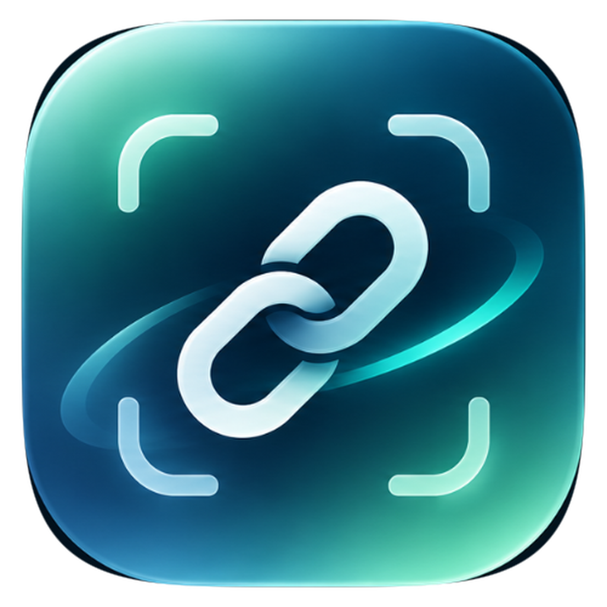

# Linkme

Linkme is a local-first link organizer for Windows. Save a URL from the clipboard, sort it into a category or group, and find it again from any app. Your library works offline and requires no account.

## Install

Download **`Linkme_0.1.0_x64-setup.exe`** from [v0.1.0 on GitHub Releases](https://github.com/medsallemi/linkme/releases/tag/v0.1.0). Linkme targets **Windows 11 x64** and requires the Microsoft Edge WebView2 Evergreen Runtime. Setup can obtain the runtime if your network and device policy allow it.

The installer is **unsigned**. Windows may warn about or block it. Compare its SHA-256 with `SHA256SUMS.txt` from the release, and leave your Windows security protections in place. Quit Linkme from the tray before installing an update.

## Quick start

| Action | Shortcut or location |
| --- | --- |
| Capture a copied URL | **Ctrl+Shift+L**. Save with a title and collection, or enable Quick-save to send links straight to Inbox. |
| Find a link | **Ctrl+Shift+K**. Type a title, URL, note or collection name, then use the arrow keys and Enter. |
| Organize and edit | Open the Library from the Linkme tray icon. Use categories, groups, pins and link actions. |
| Set appearance or shortcuts | Open **Capture settings** in the Library. |
| Back up or restore | Open **Capture settings → Cloud backup**. Google Drive is optional. |

See the [user guide](docs/USAGE.md), [Drive backup and restore](docs/DRIVE_BACKUP.md), and [privacy and permissions](docs/PRIVACY.md). The [project website](https://linkme.bacontrack.tn/) includes the [privacy policy](https://linkme.bacontrack.tn/privacy) and [terms](https://linkme.bacontrack.tn/terms).

## Build and contribute

Linkme uses Tauri 2, Rust, React, TypeScript and SQLite. Start with [building on Windows](docs/BUILD.md) and [architecture](docs/ARCHITECTURE.md). Report ordinary bugs in [GitHub Issues](https://github.com/medsallemi/linkme/issues), and report vulnerabilities through the [security policy](SECURITY.md).

[Contributing](CONTRIBUTING.md) · [Changelog](CHANGELOG.md) · [MIT license](LICENSE) · [Bootstrap Icons license](src/assets/bootstrap-icons-LICENSE.txt)
